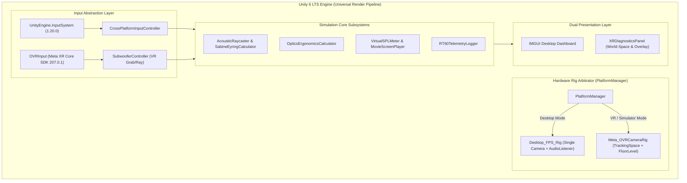

# IVRAR Group 01 — Cross-Platform XR Architecture

## 1. Architectural Philosophy & Design Goals

The core objective of the **IVRAR Group 01** home theatre simulator is to deliver a singular, maintainable codebase that executes across three distinct hardware tiers without feature fragmentation:

1. **Windows Desktop:** Mouse and keyboard first-person navigation, IMGUI HUD, and raycasted direct manipulation for non-VR development and evaluation.
2. **Windows PCVR:** OpenXR-driven high-fidelity immersion with 6DoF tracking, Meta Quest Link/AirLink, and Meta XR Simulator support.
3. **Meta Quest 2 Standalone:** Android ARM64 package utilizing URP mobile-optimized forward rendering, Vulkan/OpenGL ES 3.0, and Meta XR Audio spatialization.



---

## 2. Meta XR SDK & Building Blocks Foundation

The project integrates genuine Meta XR packages installed via Unity's package manager:

- **Meta XR Core SDK (`com.meta.xr.sdk.core` v207.0.1):** Provides the fundamental tracking runtime, camera rig management, OVRManager, and Building Block metadata registry.
- **Meta XR Interaction SDK (`com.meta.xr.sdk.interaction` v207.0.1):** Standardized input models, ray interactors, distance grabbing, and controller models.
- **Meta XR Audio SDK (`com.meta.xr.sdk.audio` v85.0.0):** Spatial acoustic reflections, room modeling, and ambisonic/binaural filtering.

### Verified Building Block Identifiers

In strict adherence to project guidelines, all Building Block identifiers match the official Meta registry defined in `Meta.XR.BuildingBlocks.Editor.BlockDataIds`:

| Building Block Name | Official Meta Block ID | Hierarchy Target in Scene |
| :--- | :--- | :--- |
| **CameraRig** | `e47682b9-c270-40b1-b16d-90b627a5ce1b` | `Cinema_Environment/XR_and_Desktop_Rigs/Meta_OVRCameraRig` |
| **ControllerTracking** | `5817f7c0-f2a5-45f9-a5ca-64264e0166e8` | `OVRControllerPrefab_Left` and `OVRControllerPrefab_Right` |
| **SpatialAudio** | `6737262b-4fab-4779-a38b-fe74012fa505` | Registered via `Assets/Resources/MetaXRAudioSettings.asset` |

---

## 3. Camera & AudioListener Arbitrage

Having multiple active `AudioListener` or competing primary `Camera` components causes rendering artifacts, frame stuttering, and spatial audio distortion.

The project enforces single-rig discipline via [`PlatformManager.cs`](file:///D:/NMIMS-MPSTME-IVRAR-2026/Group_01_Meahaan_Amogh_Harshit_Rannbir/Assets/_Project/Scripts/Platform/PlatformManager.cs):

```csharp
public void InitializeRigs()
{
    bool useVR = (activePlatformMode == PlatformMode.MetaQuestStandalone || activePlatformMode == PlatformMode.WindowsPCVR);

    if (useVR && metaXRRig != null)
    {
        if (desktopRig != null) desktopRig.SetActive(false);
        metaXRRig.SetActive(true);
        metaXRRig.transform.position = spawnPosition;
        metaXRRig.transform.rotation = Quaternion.LookRotation(spawnForward);
        ActiveCameraName = "OVRCameraRig (Meta XR)";
    }
    else
    {
        if (metaXRRig != null) metaXRRig.SetActive(false);
        if (desktopRig != null)
        {
            desktopRig.SetActive(true);
            desktopRig.transform.position = spawnPosition;
            desktopRig.transform.rotation = Quaternion.LookRotation(spawnForward);
            ActiveCameraName = "Desktop Camera (FPS Controller)";
        }
    }
}
```

- When in **Desktop Mode**: `Meta_OVRCameraRig` is deactivated, and `Desktop_FPS_Rig` handles rendering and audio listening at eye level ($y = 1.15\text{ m}$).
- When in **VR / Simulator Mode**: `Desktop_FPS_Rig` is deactivated, and `CenterEyeAnchor` on `Meta_OVRCameraRig` acts as the single active `AudioListener` and HMD camera.

---

## 4. Input Architecture & New Input System Reconciliation

### Root-Cause Resolution
Unity 6 LTS defaults to `activeInputHandler: 1` (`UnityEngine.InputSystem`). Attempting to call `Input.GetAxisRaw`, `Input.GetMouseButton`, or `Input.GetKeyDown` previously threw `InvalidOperationException` every frame.

### Unified Input Solution
1. **Primary Input:** [`CrossPlatformInputController.cs`](file:///D:/NMIMS-MPSTME-IVRAR-2026/Group_01_Meahaan_Amogh_Harshit_Rannbir/Assets/_Project/Scripts/Input/CrossPlatformInputController.cs), [`CinemaUIDashboard.cs`](file:///D:/NMIMS-MPSTME-IVRAR-2026/Group_01_Meahaan_Amogh_Harshit_Rannbir/Assets/_Project/Scripts/UI/CinemaUIDashboard.cs), and [`SubwooferController.cs`](file:///D:/NMIMS-MPSTME-IVRAR-2026/Group_01_Meahaan_Amogh_Harshit_Rannbir/Assets/_Project/Scripts/Audio/SubwooferController.cs) read input using `Keyboard.current` and `Mouse.current` via `UnityEngine.InputSystem`.
2. **Safe Fallback:** All legacy calls are wrapped in defensive `try/catch` blocks.
3. **ProjectSettings Bridge:** `activeInputHandler` is set to `2` (`Both`), enabling full compatibility with OpenXR, Meta XR Simulator, and editor extensions.

---

## 5. VR Controller Tracking & Interactivity Pipeline

The `Meta_OVRCameraRig` structure houses both controller anchors:
- `LeftControllerAnchor` holds `OVRControllerPrefab_Left` configured with `OVRControllerHelper` (`m_controller = LTouch`).
- `RightControllerAnchor` holds `OVRControllerPrefab_Right` configured with `OVRControllerHelper` (`m_controller = RTouch`).

The interactive `Subwoofer_LFE` object implements dual interaction:
1. **Desktop Mouse Drag:** Raycasted from active camera onto a floor-level plane ($y = 0.25\text{ m}$), clamped to room bounds ($x \in [-2.1, 2.1]\text{ m}$, $z \in [-3.1, 3.1]\text{ m}$).
2. **VR Controller Grabbing:** Polled via `OVRInput.Button.PrimaryHandTrigger` and `PrimaryIndexTrigger`. Supports direct proximity grabbing ($r \le 1.2\text{ m}$) and ray-aimed manipulation along the floor plane.
